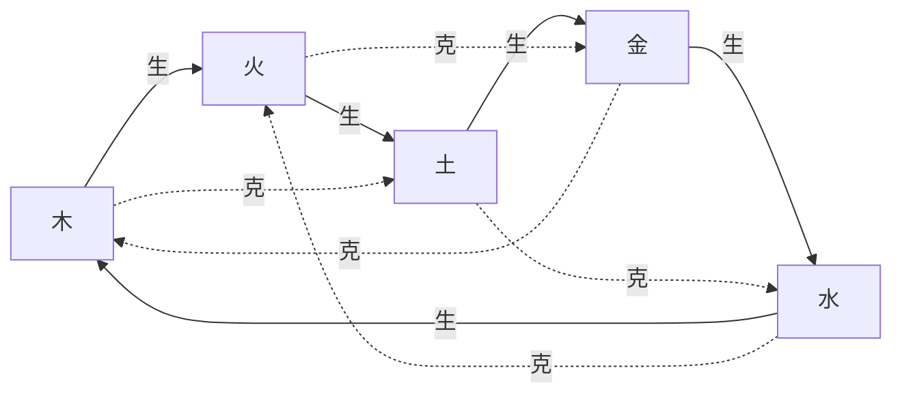

# 五行生克

## 生与克

- 相生：木生火、火生土、土生金、金生水、水生木
- 相克：木克土、土克水、水克火、火克金、金克木
- **生和克本身没有好坏**，好坏要看谁是 [[用神]]。见 [[生克没有善恶]]。

各五行的类象见 [[五行·木]] · [[五行·火]] · [[五行·土]] · [[五行·金]] · [[五行·水]]。

## 旺相休囚死（按月建）

当令者**旺**，令所生者**相**，生令者**休**，克令者**囚**，令所克者**死**。

| 月建 | 旺 | 相 | 休 | 囚 | 死 |
|---|---|---|---|---|---|
| 寅卯（春·木） | 木 | 火 | 水 | 金 | 土 |
| 巳午（夏·火） | 火 | 土 | 木 | 水 | 金 |
| 申酉（秋·金） | 金 | 水 | 土 | 火 | 木 |
| 亥子（冬·水） | 水 | 木 | 金 | 土 | 火 |
| 辰戌丑未（土） | 土 | 金 | 火 | 木 | 水 |

旺、相为**有气**；休、囚、死为**无气**。但无气不等于没用 —— 日辰生扶、动爻相生、动而化回头生，都能让一个休囚的爻起来。
完整的判法见 [[旺衰]]。

> [!note] 这张表只说"现在"
> 旺衰是对着**这一卦的月建**算的。拿它去断"当年"的事是越界。见 [[月建只管现在]]。

## 十二长生（六爻主要用四个位）

| 五行 | 长生 | 帝旺 | 墓 | 绝 |
|---|---|---|---|---|
| 木 | 亥 | 卯 | 未 | 申 |
| 火 | 寅 | 午 | 戌 | 亥 |
| 金 | 巳 | 酉 | 丑 | 寅 |
| 水 | 申 | 子 | 辰 | 巳 |
| 土（火土同宫） | 寅 | 午 | 戌 | 亥 |

完整十二位：长生 → 沐浴 → 冠带 → 临官 → 帝旺 → 衰 → 病 → 死 → 墓 → 绝 → 胎 → 养。

- **墓**：收藏、困住、昏沉、到了尽头，见 [[入墓与随鬼入墓]]。
- **绝**：断了来路；动爻化绝（化出之支是本爻的绝地）主事中途没了根。
- **长生**：动爻化长生、或日辰为其长生，主有源头、慢慢起来。

> [!warning] 流派
> 站点引擎取**火土同宫**（土墓戌、绝亥）。另一派**水土同宫**（土长生申、墓辰、绝巳）。
> 本库跟随引擎。读别家书时注意换算。见 [[引擎与断法对照]]。
