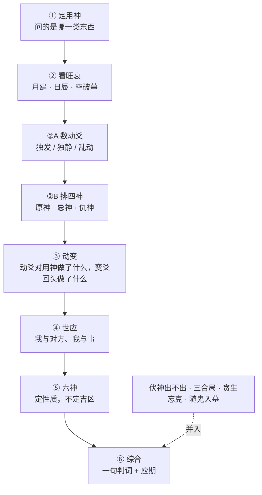

# 断卦总纲

**六步，按顺序，一步都不跳，每一步都围着用神转。**

## ① 定用神

问题是什么，用神就是什么。先在心里定，**再在解读里说出来：读的是哪一爻、为什么是它**。
能定出用神，这个问题就能读。见 [[用神]]。

## ② 看旺衰（月建 + 日辰）

- 月建定季节的旺衰（[[五行生克|旺相休囚死]]），日辰最有决定力（生、克、冲、合都算）。
- 被月建冲而无气 → [[月破]]；静爻被日冲 → [[暗动与日破|暗动或日破]]。
- [[旬空]] 先分真假再用：旺不为空、动不为空、有生扶不为空。
- 入墓而又受克 → 凶，见 [[入墓与随鬼入墓]]。
- 粗判：**旺 + 得生 + 不空不破 → 吉；休囚 + 受克 + 空破墓 → 凶。**

### ②A 数动爻

一爻独发，整卦的话就集中在这一爻和它的变爻上；六爻全静，分量就全落在用神本身的旺衰、世应、日月（含暗动）上。
**说清楚这一卦是哪一种。** 见 [[独发与独静]]。

### ②B 排四神

[[原神忌神仇神|原神]]在不在、有没有力、生不生用神？忌神动不动、克不克用神？
**这两问对结论的决定力，比任何单独一爻都大。**

## ③ 动爻与变爻

- 静卦：按用神在月日下的强弱断。
- 动卦：看每个动爻对用神是生还是克。
- 变爻回头：回头生、回头克、化进、化退、化空、化墓、化绝。见 [[动爻与变爻]]。
- 角色转化：忌神化出用神（险中得助）、忌神化出原神（威胁转弱，转吉）、原神化出忌神（帮手变了卦，先好后坏）、用神化空墓绝（中途没了）。
- 卦的性质：[[六合卦]] 易成，[[六冲卦]] 易散，[[伏吟与反吟|反吟]] 反复，伏吟 停滞。

## ④ 世应

世是自己，应是对方或事情的落点。生合 → 和；冲克 → 阻；应空、应动、应化 → 对方未定。见 [[世应]]。

## ⑤ 六神

只定性，不定吉凶，而且只用盘上给的。见 [[六神]]。

## ⑥ 综合

**一句判词**：用神状态 + 动爻作用 + 世应 → 成 / 不成 / 吉 / 凶 / 进 / 守。不骑墙。
- 判词怎么定极性、怎么和应期对齐，见 [[判词先行与极性]]。
- 断语敢下到多硬，见 [[吉凶判定与把握度]]。
- 凶卦要给"眼下能自己做、不花钱的那一件事"，不渲染宿命。见 [[解读铁律]]。

## 并入第⑥步的四件事

| | 一句话 | 笔记 |
|---|---|---|
| 伏神 | 用神不上卦时，判它**出不出伏**，不是只点名 | [[伏神与飞神]] |
| 三合局 | 三支成局，力量远大于单爻；用神在局中就被裹着走 | [[三合局]] |
| 贪生忘克 | 要克用神的那一爻自己正在被生，就忘了去克 | [[贪生忘克]] |
| 随鬼入墓 | 用神（尤其世爻）跟着官鬼进墓，事和人都睡过去，直到墓被冲开 | [[入墓与随鬼入墓]] |

## 最后：应期

问"什么时候"的，应期是主菜；没问的，不要硬塞。见 [[应期]]。

> [!tip] 动笔之前
> 盘要先**整个读完**再写：每个动爻、用神、世应、出现的六神、所有标了合 / 冲 / 空 / 墓 / 局的地方 ——
> 哪些承这一问的重，哪些对这一问是噪声，先分好。然后一口气写完。见 [[立场先行]]。
