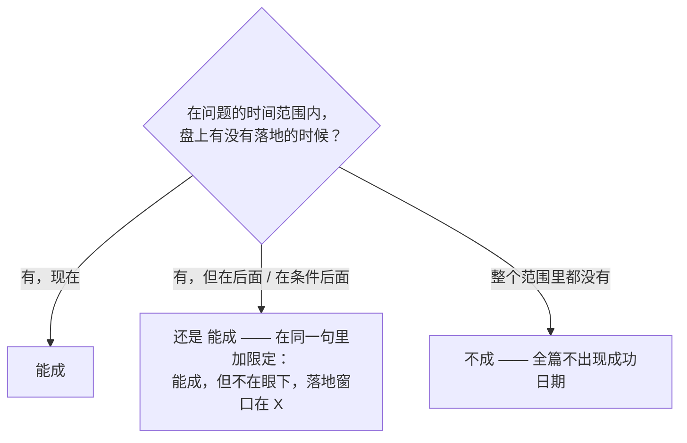

# 判词先行与极性

摆完盘、点完用神，在逐步分析**之前**，先给一个完整、自足的回答：读到这里就停下的人，也已经拿到答案了。

1. **用它自己的话、在它自己的时间尺度上重述问题**：「你问的是「以后」—— 不是现在 —— 能不能住进那里。」答了另一个问题，后面全白写。
2. **一个净判词**，一句话，下定。有条件就在同一口气里说条件：「能成，但要过两道坎：A 和 B。」
3. 两三个决定性的理由，用生活的话说：最主要的帮力、最主要的阻力、**哪个赢、为什么**。
4. 时间是答案的一部分时，和问题尺度相符的时间锚也放在这里。

## 极性：先看整条时间线

判词的第一个字，来自你要铺开的**整条时间线**，不来自现在的状态。

- **"不成"和一个成功日期不许同时出现。** 你发现自己在写"什么时候成"，判词就写错了 —— 是"能成（要等 / 要过坎）"，回去改第一句。
- 交稿前把判词句和时间句并排读一遍：两者极性打架，**错的是判词句**。

## 有期限的问题

"毕业前""年底前""30 岁之前"：判词是对**那个窗口**的判词，并且要说出来 ——「毕业前：成不了。」
若盘上显示落在期限之后，两半是**一个判词，一口气说完**：
> 在你问的期限内成不了；但这事本身是活的，落地窗口在毕业后的 X 年。

拆开说（开头一个光秃秃的"不成"，转机埋在后面）读起来就是自相矛盾。

负面判词之后提到的每一个有利信号，要在同一口气里交代它和判词的关系：
它是"**为什么仍然翻不了盘**"（底子过硬，但底子是长跑的本钱，救不了毕业前这两年），还是"**期限后的本钱**"。悬着不交代，读起来像解读在跟自己吵。

## 净方向，全篇只定一次

混合信号在这里**权衡一次**，然后整篇守住这个方向。后面的段落加细节、加条件，**从不翻转、不摇摆**
（"看起来能成……其实难……也许又能"是这条规则要消灭的头号毛病）。
盘真的一分为二，那判词**就是**这个分叉，说成一个清楚的结构：「五五开，分岔点是 X：X 立住 → 成；立不住 → 不成。」
